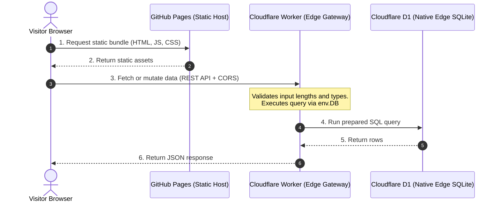

# D1 Pages Starter

[](LICENSE)
[](https://pages.github.com/)
[](https://workers.cloudflare.com/)
[-f38020?logo=sqlite)](https://developers.cloudflare.com/d1/)

Starter template and interactive generator for web applications hosted on GitHub Pages with an edge API on Cloudflare Workers and SQLite storage in Cloudflare D1 or Turso.

---

## Interactive CLI

Scaffold a complete application with your choice of database, edge backend, and frontend.

```bash
# Using bun:
bun create d1-pages my-edge-app

# Using npx / npm:
npx create-d1-pages my-edge-app

# From cloned repository:
git clone https://github.com/riccivr/d1-pages-starter.git
cd d1-pages-starter
node bin/cli.js
```

### Terminal walkthrough

```text
? What is your project name? my-edge-app

? Select your database engine:
  ❯ Cloudflare D1 (Recommended) - Serverless SQLite, native worker binding, 5GB free
    Turso (libSQL)              - Distributed SQLite over HTTP, 9GB storage free

? Select your edge backend language:
  ❯ TypeScript (Recommended)         - V8 native, fastest development
    Rust (WebAssembly / worker-rs)   - Compiled Wasm, ultra-low memory, type safety
    Python (Native Worker)           - Pyodide Wasm runtime, native D1 support

? Select your frontend framework:
  ❯ Vanilla HTML/CSS/JS - Zero build step, runs instantly in browser
    React + Vite        - TypeScript, Tailwind CSS, Lucide icons, optimistic UI
    Astro               - Static site generator with interactive client islands
    Svelte 5            - Svelte 5 runes, Vite, TypeScript, ultra-lean bundle

? Select an application preset:
  ❯ Community Guestbook / Feed - Comments, author handles, timestamps
    Waitlist & Newsletter      - Email signup form with validation
    Upvote & Counters          - Atomic pageview and like increments

? Include automated GitHub Actions CI/CD workflows for GitHub Pages & Workers? (Y/n)
```

### Supported options

| Category | Options | Details |
| :--- | :--- | :--- |
| Database | Cloudflare D1, Turso | D1 uses direct `env.DB` bindings. Turso uses `@libsql/client` over HTTP. |
| Backend | TypeScript, Rust, Python | TypeScript runs on V8. Rust compiles to Wasm via `worker-rs`. Python runs on Pyodide. |
| Frontend | Vanilla JS, React, Astro, Svelte 5 | Vanilla requires no build step. React, Astro, and Svelte compile to static files for GitHub Pages. |
| Preset | Guestbook, Waitlist, Counters | Generates SQL schema tables, indexes, and matching REST endpoints. |
| CI/CD | GitHub Actions | Workflows for GitHub Pages and Cloudflare Workers deployment. |

---

## Why this stack

* No third-party database account needed. D1 runs inside Cloudflare next to your Worker, bound directly via `env.DB`. There are no database passwords or tokens to rotate.
* Works offline. Wrangler emulates D1 locally with SQLite. Run `wrangler d1 execute --local` to test queries without network calls.
* Credentials stay off the client. GitHub Pages serves static files only. The Worker handles CORS, validates payloads, and runs prepared SQL statements.

---

## Architecture



---

## Free tier limits

| Component | Provider | Free tier allowance | Notes |
| :--- | :--- | :--- | :--- |
| Frontend | GitHub Pages | Unlimited public repositories, 100 GB/month bandwidth | Static asset hosting with automated git deployments. |
| Edge API | Cloudflare Workers | 100,000 requests/day, 10ms CPU time per request | Handles routing, CORS, and request validation. |
| Database | Cloudflare D1 | 5 GB storage, 5,000,000 reads/day, 100,000 writes/day | Serverless SQLite with zero connection strings. |

---

## Project layout

```
d1-pages-starter/
├── .github/workflows/
│   ├── deploy-pages.yml         # GitHub Actions workflow for GitHub Pages
│   └── deploy-worker.yml        # GitHub Actions workflow for Cloudflare Workers
├── worker/                      # Edge Worker API
│   ├── src/index.ts             # REST endpoints, CORS, and D1 queries
│   ├── schema.sql               # SQLite schema definition
│   ├── wrangler.jsonc           # Worker configuration and D1 binding
│   └── package.json
├── templates/
│   ├── vanilla/                 # HTML, CSS, and modern JS without build tools
│   ├── react/                   # Vite, React, TypeScript, and Tailwind CSS
│   ├── astro/                   # Astro static output with interactive island
│   └── svelte/                  # Svelte 5 with Vite and TypeScript
├── scripts/
│   └── setup-db.sql             # SQL table definitions and indexes
└── index.html                   # Repository showcase page
```

---

## Quick start

### 1. Create your Cloudflare D1 database

Log in with Wrangler:
```bash
npx wrangler login
```

Create the database:
```bash
npx wrangler d1 create pages-d1-db
```

Wrangler prints the binding configuration:
```text
[[d1_databases]]
binding = "DB"
database_name = "pages-d1-db"
database_id = "xxxxxxx-xxxx-xxxx-xxxx-xxxxxxxxxxxx"
```

Open `worker/wrangler.jsonc` and replace `YOUR_DATABASE_ID_HERE` with your `database_id`:
```jsonc
"d1_databases": [
  {
    "binding": "DB",
    "database_name": "pages-d1-db",
    "database_id": "xxxxxxx-xxxx-xxxx-xxxx-xxxxxxxxxxxx"
  }
]
```

### 2. Initialize schema and deploy the worker

Run the SQL migration on your remote D1 database:
```bash
cd worker
npm run db:init:remote
```

Deploy the worker:
```bash
npm run deploy
```

Wrangler prints the live endpoint URL. Test the health check:
```bash
curl https://d1-pages-api.<user>.workers.dev/api/health
```

### 3. Choose and configure your frontend

Templates in `templates/`:

| Template | Directory | Dependencies | Build step |
| :--- | :--- | :--- | :--- |
| Vanilla | `templates/vanilla/` | None | None |
| React | `templates/react/` | Vite, React 18/19, Tailwind CSS | `npm run build` |
| Astro | `templates/astro/` | Astro | `npm run build` |
| Svelte | `templates/svelte/` | Svelte 5, Vite | `npm run build` |

Set the worker URL:
* Vanilla JS: in `templates/vanilla/config.js`, set `API_BASE_URL: "https://d1-pages-api.<user>.workers.dev"`.
* React or Svelte: in `.env`, set `VITE_API_URL=https://d1-pages-api.<user>.workers.dev`.
* Astro: in `.env`, set `PUBLIC_API_URL=https://d1-pages-api.<user>.workers.dev`.

### 4. Deploy to GitHub Pages

#### Option A: GitHub Actions (automated)
1. Push this repository to GitHub.
2. In repository Settings > Pages > Build and deployment, set Source to **GitHub Actions**.
3. Under the Actions tab, run **Deploy to GitHub Pages** and pick your template (`vanilla`, `react`, `astro`, `svelte`, or `root-showcase`).

#### Option B: Deploy from a branch
Copy `templates/vanilla` to your repository root or `docs/` folder, then select that branch and folder in repository Pages settings.

---

## Local development

D1 runs locally using SQLite:

1. Create the local database and run the schema:
   ```bash
   cd worker
   npm run db:init:local
   ```

2. Start the worker:
   ```bash
   npm run dev
   # Listens on http://localhost:8787
   ```

3. Start your frontend dev server:
   ```bash
   cd templates/react
   npm install
   npm run dev
   # Vite serves at http://localhost:5173 and proxies to http://localhost:8787
   ```

---

## Security

1. Restrict CORS origins. `worker/wrangler.jsonc` defaults to `"ALLOWED_ORIGIN": "*"`. Before production, set this to your GitHub Pages URL:
   ```jsonc
   "vars": {
     "ALLOWED_ORIGIN": "https://<your-username>.github.io"
   }
   ```
2. Keep secrets out of frontend code. D1 uses worker bindings (`env.DB`), so no database tokens or passwords exist in client bundles.
3. Protected routes. To restrict deletions or admin actions, configure `ADMIN_API_KEY` using `wrangler secret put ADMIN_API_KEY`. The worker requires `Authorization: Bearer <key>` on `DELETE /api/posts/:id`.
4. Input validation. The worker checks string lengths, trims whitespace, and uses parameterized statements (`env.DB.prepare(...).bind(...)`) to prevent SQL injection.

---

## Other use cases

The included starter implements a guestbook feed. Common adaptations:
* Blog comments: add a `post_slug` column to filter comments per post.
* Polls and votes: add a `counters` table with atomic updates (`UPDATE counters SET count = count + 1 WHERE id = ?`).
* Pageview counter: increment a counter on route loads.
* Waitlist form: store emails with a unique constraint and timestamp.

---

## License

MIT
