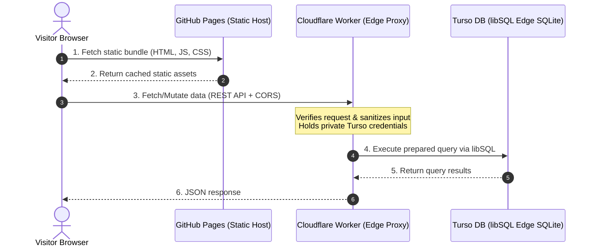

# Turso Pages Starter 🚀

[](LICENSE)
[](https://pages.github.com/)
[](https://workers.cloudflare.com/)
[-00e5a3?logo=sqlite)](https://turso.tech/)

A baseline template and starter kit for building **100% free full-stack web applications** by connecting **GitHub Pages** (static frontend) with **Turso** (distributed SQLite/libSQL database) via **Cloudflare Workers** (secure edge proxy).

Includes ready-to-run frontend templates for **Vanilla JS**, **React + Vite**, **Astro**, and **Svelte 5**.

---

## 🏗️ Architecture

GitHub Pages is a static host and cannot safely store private database credentials. Placing a Turso authentication token directly in client-side code would expose your database to the public.

To keep the stack completely free while maintaining enterprise-grade security and sub-millisecond edge latency, this starter uses a lightweight **Cloudflare Worker** as a secure edge gateway:



---

## 💸 The 100% Free Tier Breakdown

| Component | Provider | Free Tier Quota | Why it matters |
| :--- | :--- | :--- | :--- |
| **Frontend** | **GitHub Pages** | Unlimited public sites, 100 GB/month bandwidth | Fast worldwide CDN, instant deploys from Git. |
| **Edge Proxy** | **Cloudflare Workers** | 100,000 requests/day, 10ms CPU time/req | Secure token vault, zero cold starts, global routing. |
| **Database** | **Turso** | 9 GB total storage, 500 databases, 1B row reads/mo | Serverless SQLite with prepared statement performance. |

---

## 📦 What's Included

```
turso-pages-starter/
├── .github/workflows/
│   ├── deploy-pages.yml         # 1-click CI/CD to build & deploy any template
│   └── deploy-worker.yml        # CI/CD to deploy Cloudflare Worker on push
├── worker/                      # Cloudflare Worker edge proxy (TypeScript)
│   ├── src/index.ts             # REST API, CORS handling, validation, error handler
│   ├── schema.sql               # SQLite schema definition
│   ├── wrangler.jsonc           # Wrangler configuration
│   └── package.json
├── templates/
│   ├── vanilla/                 # Zero build step, plain HTML + CSS + JS
│   ├── react/                   # Vite + React 18/19 + TypeScript + Tailwind CSS
│   ├── astro/                   # Astro 4/5 static output with interactive island
│   └── svelte/                  # Svelte 5 + Vite + TypeScript
├── scripts/
│   └── setup-db.sql             # SQL script to initialize tables & indexes
└── index.html                   # Showcase landing page for GitHub Pages
```

---

## 🚀 5-Step Quick Start Guide

### Step 1: Create your Turso Database

1. Install the [Turso CLI](https://docs.turso.tech/cli/introduction) or use the [Turso Web Dashboard](https://turso.tech/):
   ```bash
   turso auth signup
   ```
2. Create a new database:
   ```bash
   turso db create my-pages-db
   ```
3. Initialize the table schema using the provided script:
   ```bash
   turso db shell my-pages-db < scripts/setup-db.sql
   ```
4. Retrieve your database URL and authentication token:
   ```bash
   turso db show my-pages-db --url
   turso db tokens create my-pages-db
   ```
   *Keep these two values handy for Step 2.*

---

### Step 2: Configure & Deploy the Cloudflare Worker

1. Navigate to the `worker/` directory:
   ```bash
   cd worker
   npm install
   ```
2. Login to Cloudflare via Wrangler:
   ```bash
   npx wrangler login
   ```
3. Set your private Turso secrets:
   ```bash
   npx wrangler secret put TURSO_DATABASE_URL
   # Paste: libsql://my-pages-db-<org>.turso.io

   npx wrangler secret put TURSO_AUTH_TOKEN
   # Paste: your-token-from-step-1
   ```
4. Deploy the worker:
   ```bash
   npm run deploy
   ```
   Wrangler will output your live URL (e.g., `https://turso-pages-api.<user>.workers.dev`). Verify health:
   ```bash
   curl https://turso-pages-api.<user>.workers.dev/api/health
   # Returns: {"status":"online","database":"connected",...}
   ```

---

### Step 3: Choose Your Frontend Template

Select the frontend starter that fits your preferences:

| Template | Directory | Features | Build Step |
| :--- | :--- | :--- | :--- |
| **Vanilla** | `templates/vanilla/` | Zero dependencies, instant preview, dark theme | None |
| **React** | `templates/react/` | Vite, TypeScript, Tailwind CSS, Lucide icons | `npm run build` |
| **Astro** | `templates/astro/` | Static site generation with reactive island | `npm run build` |
| **Svelte** | `templates/svelte/` | Svelte 5, lightweight reactive runes/components | `npm run build` |

---

### Step 4: Connect the Frontend to Your Worker

#### For Vanilla JS:
Open `templates/vanilla/config.js` and set your worker URL:
```javascript
const CONFIG = {
  API_BASE_URL: "https://turso-pages-api.<user>.workers.dev",
};
```

#### For React, Astro, or Svelte:
Create or edit `.env` in the template folder:
```bash
# React / Svelte:
VITE_API_URL=https://turso-pages-api.<user>.workers.dev

# Astro:
PUBLIC_API_URL=https://turso-pages-api.<user>.workers.dev
```

---

### Step 5: Deploy to GitHub Pages

#### Option A: Using the Included GitHub Action (Recommended)
1. Push your repository to GitHub.
2. In your repo, go to **Settings** > **Pages** > **Build and deployment**.
3. Under **Source**, select **GitHub Actions**.
4. Go to the **Actions** tab, select **Deploy to GitHub Pages**, click **Run workflow**, and pick your template (`vanilla`, `react`, `astro`, `svelte`, or `root-showcase`).

#### Option B: Deploy from Branch / Folder
If you prefer deploying without build actions, use `templates/vanilla` or move its files to your repo root / `docs/` folder, and choose **Deploy from a branch** in GitHub Pages settings.

---

## 💻 Local Development Workflow

Run both the edge worker and your frontend locally on your machine:

1. **Start the Cloudflare Worker locally**:
   ```bash
   cd worker
   cp .env.example .env
   # Fill in TURSO_DATABASE_URL and TURSO_AUTH_TOKEN
   npm run dev
   # Worker listens on http://localhost:8787
   ```

2. **Start your frontend dev server** (e.g. React):
   ```bash
   cd templates/react
   npm install
   npm run dev
   # Vite listens on http://localhost:5173 and automatically points to http://localhost:8787
   ```

---

## 🔒 Security & Production Best Practices

1. **CORS Origin Pinning**:
   By default, `worker/wrangler.jsonc` sets `ALLOWED_ORIGIN: "*"`. For production, pin this to your exact GitHub Pages domain:
   ```jsonc
   "vars": {
     "ALLOWED_ORIGIN": "https://<your-username>.github.io"
   }
   ```
2. **Never expose Turso tokens**:
   Never put `TURSO_AUTH_TOKEN` in frontend `.env` files or public GitHub repos. Keep it inside Cloudflare Worker secrets.
3. **Admin Actions**:
   To restrict deletions or moderation endpoints, set `ADMIN_API_KEY` via `wrangler secret put ADMIN_API_KEY`. The worker will require `Authorization: Bearer <key>` for `DELETE /api/posts/:id`.
4. **Input Sanitization**:
   The worker enforces character lengths, trims whitespace, and uses prepared parameterized statements (`client.execute({ sql, args })`) to prevent SQL injection.

---

## 💡 Adapting for Other Use Cases

The included example implements a **Community Guestbook / Feed**. You can easily adapt it into:
- **Blog Comments**: Add a `post_slug` column to filter comments per article.
- **Polls / Reactions**: Add a `likes` or `votes` counter table with atomic updates (`UPDATE counters SET count = count + 1 WHERE id = ?`).
- **Visitor Analytics / Pageview Counter**: Increment a count on route visits.
- **Waitlist / Contact Form**: Store submitted emails and timestamps.
- **Bookmarks / Notes**: Personal lightweight cloud notebook.

---

## 📄 License

This starter template is released under the [MIT License](LICENSE). Feel free to use it for personal or commercial projects.
