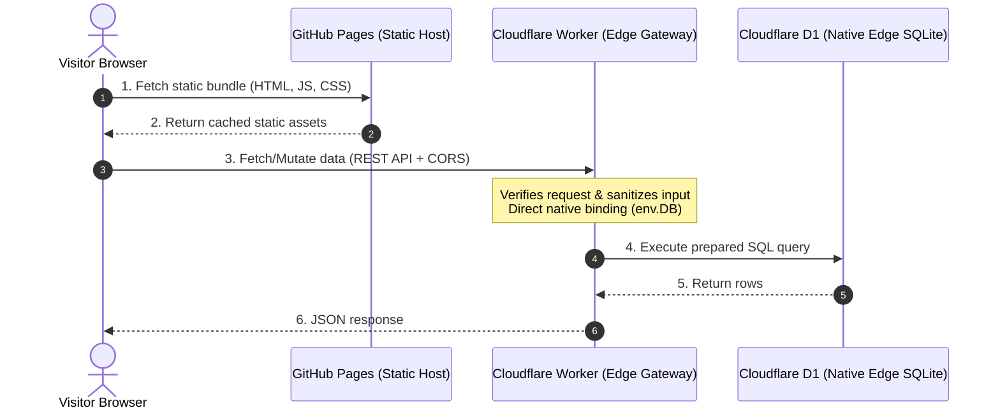

# D1 Pages Starter 🚀

[](LICENSE)
[](https://pages.github.com/)
[](https://workers.cloudflare.com/)
[-f38020?logo=sqlite)](https://developers.cloudflare.com/d1/)

A production-ready template and interactive CLI for building **100% free full-stack web applications** by connecting **GitHub Pages** (static frontend) with **Cloudflare D1** or **Turso** (serverless SQLite) via **Cloudflare Workers** (edge gateway).

---

## ⚡ Interactive CLI (Create in Seconds)

You can scaffold a customized project with interactive technology selection (similar to `bun create` / `npm create`):

```bash
# Using npx / npm:
npx create-d1-pages my-edge-app

# Or directly from this repository:
node bin/cli.js
```

### Interactive Prompts:
* 📁 **Project Name**: Choose target directory name
* 🗄️ **Database Engine**: Cloudflare D1 (Native SQLite) or Turso (libSQL)
* 🎨 **Frontend**: Vanilla JS (Zero-build), React + Vite, Astro, or Svelte 5
* 🧩 **App Preset**: Guestbook / Feed, Waitlist / Newsletter, or Upvote / Reaction Counters
* 🤖 **CI/CD**: Auto-configure GitHub Actions for GitHub Pages and Cloudflare Workers

---

## 🌟 Why this stack?

1. **No External Database Provider Needed**: The database is hosted directly inside Cloudflare right next to your Worker. You do not need to register with a 3rd-party database service or manage secret tokens.
2. **Instant Offline Development**: Wrangler emulates D1 locally using embedded SQLite. You can develop and test offline with zero network calls and zero cloud setup (`wrangler d1 execute --local`).
3. **Rock-Solid Security**: GitHub Pages serves static files only. The Worker acts as an edge gateway: verifying requests, sanitizing inputs, pinning CORS origins, and executing prepared queries.

---

## 🏗️ Architecture



---

## 💸 The 100% Free Tier Breakdown

| Component | Provider | Free Tier Quota | Why it matters |
| :--- | :--- | :--- | :--- |
| **Frontend** | **GitHub Pages** | Unlimited public sites, 100 GB/month bandwidth | Fast global CDN, instant deployments from Git. |
| **Edge Gateway** | **Cloudflare Workers** | 100,000 requests/day, 10ms CPU time/req | Low-latency edge compute, handles CORS & validation. |
| **Database** | **Cloudflare D1** | 5 GB storage, 5M reads/day, 100k writes/day | Native SQLite embedded in Workers. Zero credentials needed. |

---

## 📦 What's Included

```
d1-pages-starter/
├── .github/workflows/
│   ├── deploy-pages.yml         # 1-click CI/CD to build & deploy any template to GitHub Pages
│   └── deploy-worker.yml        # CI/CD to deploy Cloudflare Worker automatically
├── worker/                      # Cloudflare Worker edge gateway (TypeScript)
│   ├── src/index.ts             # REST API, CORS handling, validation, native env.DB queries
│   ├── schema.sql               # SQLite schema definition
│   ├── wrangler.jsonc           # Wrangler configuration with D1 database binding
│   └── package.json
├── templates/
│   ├── vanilla/                 # Zero build step, plain HTML + CSS + JS
│   ├── react/                   # Vite + React 18/19 + TypeScript + Tailwind CSS
│   ├── astro/                   # Astro 4/5 static output with interactive island
│   └── svelte/                  # Svelte 5 + Vite + TypeScript
├── scripts/
│   └── setup-db.sql             # SQL script to initialize tables & indexes
└── index.html                   # Showcase landing page for GitHub Pages
```

---

## 🚀 4-Step Quick Start Guide

### Step 1: Create your Cloudflare D1 Database

1. Login to Cloudflare via Wrangler:
   ```bash
   npx wrangler login
   ```
2. Create your D1 database:
   ```bash
   npx wrangler d1 create pages-d1-db
   ```
   Wrangler will output something like:
   ```text
   [[d1_databases]]
   binding = "DB"
   database_name = "pages-d1-db"
   database_id = "xxxxxxx-xxxx-xxxx-xxxx-xxxxxxxxxxxx"
   ```
3. Open `worker/wrangler.jsonc` and replace `YOUR_DATABASE_ID_HERE` with your `database_id`:
   ```jsonc
   "d1_databases": [
     {
       "binding": "DB",
       "database_name": "pages-d1-db",
       "database_id": "xxxxxxx-xxxx-xxxx-xxxx-xxxxxxxxxxxx"
     }
   ]
   ```

---

### Step 2: Initialize the Database Schema & Deploy Worker

1. Initialize the tables in your remote D1 database:
   ```bash
   cd worker
   npm run db:init:remote
   ```
2. Deploy the Worker:
   ```bash
   npm run deploy
   ```
   Wrangler will output your live URL (e.g. `https://d1-pages-api.<user>.workers.dev`). Test the health endpoint:
   ```bash
   curl https://d1-pages-api.<user>.workers.dev/api/health
   # Returns: {"status":"online","database":"Cloudflare D1 (connected)",...}
   ```

---

### Step 3: Choose & Configure Your Frontend Template

Select any template from `templates/`:

| Template | Directory | Features | Build Step |
| :--- | :--- | :--- | :--- |
| **Vanilla** | `templates/vanilla/` | Zero dependencies, instant preview, dark theme | None |
| **React** | `templates/react/` | Vite, TypeScript, Tailwind CSS, Lucide icons | `npm run build` |
| **Astro** | `templates/astro/` | Static site generation with reactive island | `npm run build` |
| **Svelte** | `templates/svelte/` | Svelte 5, lightweight reactive runes | `npm run build` |

#### Set your Worker API URL:
* **Vanilla JS**: In `templates/vanilla/config.js`, set `API_BASE_URL: "https://d1-pages-api.<user>.workers.dev"`.
* **React / Svelte**: In `.env`, set `VITE_API_URL=https://d1-pages-api.<user>.workers.dev`.
* **Astro**: In `.env`, set `PUBLIC_API_URL=https://d1-pages-api.<user>.workers.dev`.

---

### Step 4: Deploy to GitHub Pages

#### Option A: Using the Included GitHub Action (Recommended)
1. Push your repository to GitHub.
2. In your repo, navigate to **Settings** > **Pages** > **Build and deployment**.
3. Under **Source**, select **GitHub Actions**.
4. Go to the **Actions** tab, select **Deploy to GitHub Pages**, click **Run workflow**, and pick your template (`vanilla`, `react`, `astro`, `svelte`, or `root-showcase`).

#### Option B: Deploy from Branch / Folder
If deploying without build steps, use `templates/vanilla` or copy its files to the repo root / `docs/` folder, and choose **Deploy from a branch** in GitHub Pages settings.

---

## 💻 Local Development Workflow

Cloudflare D1 runs completely offline on your local machine using SQLite:

1. **Initialize local SQLite database**:
   ```bash
   cd worker
   npm run db:init:local
   ```
2. **Start the Worker**:
   ```bash
   npm run dev
   # Listens on http://localhost:8787 and binds to local SQLite D1
   ```
3. **Start your frontend dev server** (e.g. React):
   ```bash
   cd templates/react
   npm install
   npm run dev
   # Vite serves at http://localhost:5173, pointing automatically to http://localhost:8787
   ```

---

## 🔒 Security & Production Best Practices

1. **CORS Origin Pinning**:
   By default, `worker/wrangler.jsonc` sets `"ALLOWED_ORIGIN": "*"`. Before launching to production, restrict it to your GitHub Pages URL:
   ```jsonc
   "vars": {
     "ALLOWED_ORIGIN": "https://<your-username>.github.io"
   }
   ```
2. **Zero Credential Exposure**:
   Because D1 uses native Cloudflare Worker bindings (`env.DB`), there are no database connection strings or passwords that could accidentally leak in frontend code.
3. **Admin Actions**:
   To protect deletions, set `ADMIN_API_KEY` via `wrangler secret put ADMIN_API_KEY`. The worker will require an `Authorization: Bearer <key>` header on `DELETE /api/posts/:id`.
4. **Input Sanitization**:
   The worker enforces character lengths, trims whitespace, and uses prepared parameterized statements (`env.DB.prepare(...).bind(...)`) to prevent SQL injection.

---

## 💡 Adapting for Other Use Cases

The included example implements a **Community Guestbook / Feed**. You can easily adapt it into:
* **Blog Comments**: Add a `post_slug` column to filter comments per article.
* **Polls / Reactions**: Add a `counters` table with atomic updates (`UPDATE counters SET count = count + 1 WHERE id = ?`).
* **Visitor Analytics**: Increment a view count on page loads.
* **Waitlist / Contact Form**: Store submitted emails and timestamps.

---

## 📄 License

This starter template is released under the [MIT License](LICENSE). Feel free to use it for personal or commercial projects.
